# DDG Lab 操作实例：Step by Step

本手册按“**从哪里进入 → 点什么 → 输入什么 → 应看到什么 → 如何保存**”组织。可以按顺序练习，也可以直接选择需要的实例。截图均来自应用的实际操作画面；由于窗口大小、计算速度和当前播放帧不同，你看到的位置或数值可能略有差异。

> **重要：**本应用是教学与研究原型。预计算轨迹是数值模型的采样结果；“短时保持”不是物理抓取验收。五指动态实验为每指一个形状坐标的双向降阶模型，接触力尚未时间步收敛，布片基线未满足保持条件。请勿将本手册中的数值用于工程设计或真实物体安全判断。

## 快速目录

| 实例 | 你将完成什么 | 适合谁 |
|---|---|---|
| [开始前：进入应用](#prepare) | 启动应用、找到导航和按钮 | 第一次使用 |
| [实例 1：悬臂梁参数对比](#beam) | 找算例、改重力、回看、导出 CSV/PNG | 入门 |
| [实例 2：观察离散曲率](#curvature) | 把转角设为 60°，查看曲率和弯曲能 | 公式学习 |
| [实例 3：二维等效腱驱抓手](#gripper2d) | 查看牵引、接触与响应曲线 | 平面接触 |
| [实例 4：三维实体孔抓手](#gripper3d) | 计算 0.5 mm 短路径，查看孔口并导出 GIF | 真实孔壁入门 |
| [实例 5：五指接触固定球](#fixed-ball) | 查看五根腱与一个固定球的接触 | 五指实体模型 |
| [实例 6：回放五指抓鸡蛋](#egg) | 查看预计算轨迹、夹具释放和五指状态 | 最快体验五指动态抓取 |
| [实例 7：比较鸡蛋、螺丝刀和瓶盖](#shapes) | 切换不同形状和尺寸的预设轨迹 | 形状对比 |
| [实例 8：重新计算 4 倍刚度鸡蛋](#stiffness) | 修改刚度并启动新的后台计算 | 自己运行仿真，耗时较长 |
| [实例 9：五指接触固定圆角盒](#box) | 设置物体形状与 2 mm 短路径 | 其他物体接触 |
| [实例 10：独立指垫材料实验](#pads) | 修改材料刚度并暂停，认识与五腱模型的区别 | 模型对比 |
| [实例 11：运行验证中心](#verification) | 运行并正确理解三种检查 | 结果核查 |
| [结果保存与常见问题](#troubleshooting) | 查找下载文件、解决按钮不可用等问题 | 所有用户 |

<a id="prepare"></a>
## 开始前：进入应用

### 已有应用预览

1. 打开本会话提供的 **网站预览**，等待左侧导航和中间视图出现。
2. 电脑上直接点击左侧页面名称。手机上先点击左上角菜单按钮，再选择页面。
3. 第一次打开三维页面时，若看到“正在加载”，先等待视口和参数出现。

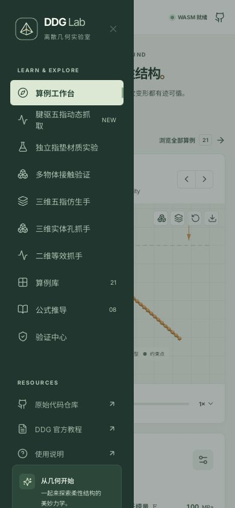

### 在自己的电脑启动

安装 Node.js 20 或更新版本（推荐 22）、npm 和 Git，在终端执行：

```bash
git clone --branch arena/7bf8ff28-mathhighschool https://github.com/hnsyliupeng/mathhighschool.git
cd mathhighschool
npm ci
npm run dev
```

用浏览器打开终端输出的 **Local** 地址，例如 `http://localhost:5173/`；端口不同则以终端为准。已经下载过项目时，不必再次克隆，进入项目目录后运行 `npm ci` 和 `npm run dev` 即可。按 `Ctrl+C` 可停止本地服务。远程预览请用平台给出的预览地址，不要在自己的电脑上输入远程机器的 `localhost`。更多安装说明见[使用说明书](USER_MANUAL.md#start)。

### 约定

- **拖动滑块**：将圆点拖到指定数值；也可将焦点放在滑块上，用方向键调整。请以滑块旁显示的数字为准。
- **应用参数**：很多页面要点击“应用并重新运行”或“应用参数并重置”，修改才会生效。
- **播放/暂停**：播放按钮通常是三角形 `▶`；运行时变为暂停符号 `Ⅱ`。在按钮上停留可以看到提示。
- **保存文件**：PNG、CSV、GIF 会由浏览器下载到你的设备，不会自动保存到 GitHub。

<a id="beam"></a>
## 实例 1：悬臂梁——搜索、改参数与导出

**目标：**比较重力加速度为 `10.0` 与 `15.0 m/s²` 时，悬臂梁在约 `1.00 s` 的测量点位移。

### 第一步：找到算例

1. 点击左侧 **算例库**。
2. 将分类保持在 **全部**；在右侧“搜索算例、章节...”输入 `悬臂梁`。
3. 找到结果 **重力下的悬臂梁**，点击整张卡片，进入算例工作台。

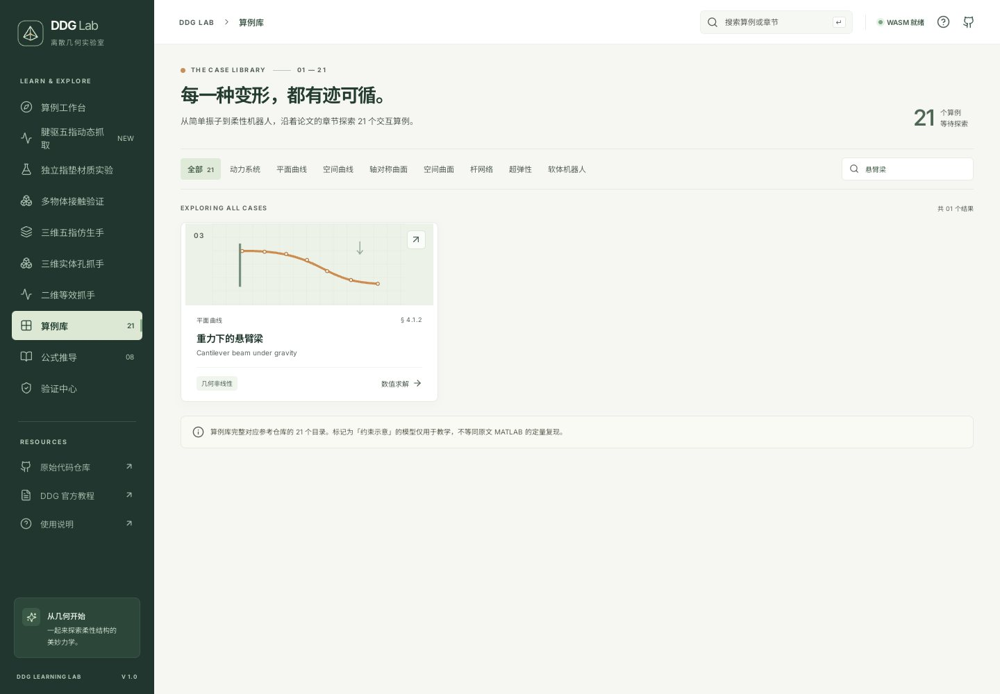

### 第二步：记录默认工况

4. 在右侧“实验参数”中，点击“应用并重新运行”旁的圆形箭头，**恢复默认参数**。
5. 确认重力为 `10.0 m/s²`、杨氏模量为 `100 MPa`、阻尼为 `0.10 s⁻¹`、离散节点为 `40`。恢复后会从初态重新播放。
6. 等视图下方的时间超过 `1.05 s`，点击**暂停**，再把时间滑条拖回约 `1.00 s`。实际显示为最近一次记录的时间；尽量比较同一时刻。
7. 向下查看 **响应分析 → 测量点位移**。本次浏览器操作在 `1.00 s` 显示约 **−0.0997 m**；记下这个值。

### 第三步：增加重力

8. 保持杨氏模量、阻尼和节点数不变，把右侧 **重力加速度**滑块调到 `15.0 m/s²`。
9. 点击 **应用并重新运行**。只拖动滑块而不点击应用，求解参数不会改变。
10. 等待时间再次超过 `1.05 s`，点击**暂停**，将历史滑条拖回约 `1.00 s`。
11. 查看“测量点位移”。本次操作显示约 **−0.2133 m**；与步骤 7 相比，所选时刻的向下位移幅值更大。实际数值以页面选中的记录时刻为准。

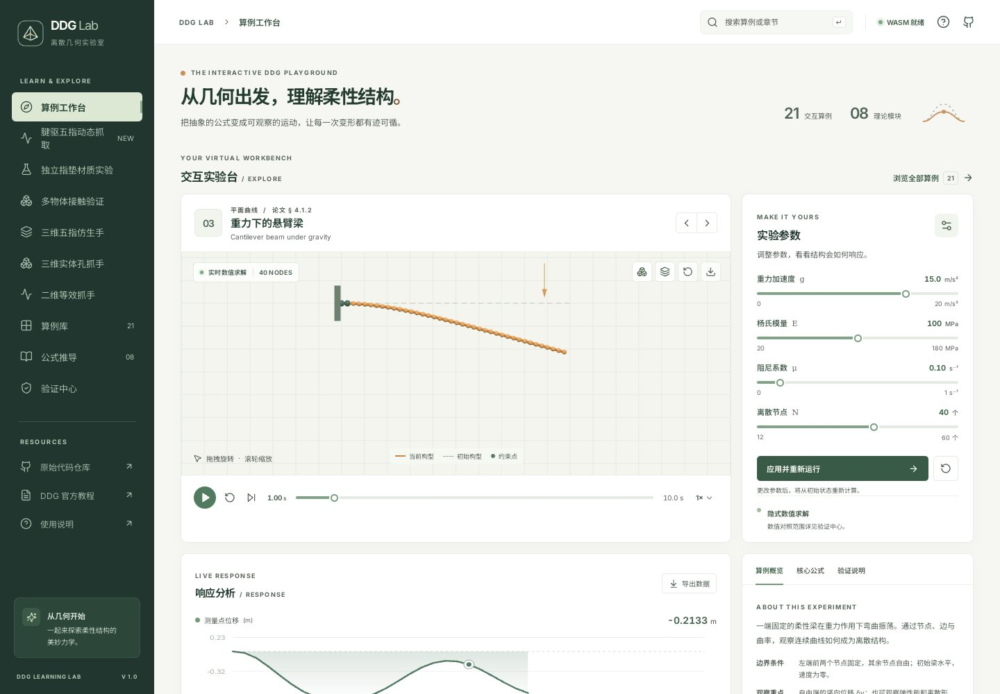

### 第四步：保存结果

12. 点击视图右上角的 **下载视图 PNG** 图标，得到类似 `ddg-beam-gravity-1.00s.png` 的当前画面。
13. 向下滚动至 **响应分析**，点击 **导出数据**，得到 `ddg-beam-gravity-data.csv`。可用表格软件查看 `time_s`、`displacement` 和单位等列。
14. 若要保存默认和修改后两份数据，请在**应用另一组参数前**分别导出，并将文件重命名，例如 `beam-g10.csv`、`beam-g15.csv`。

> CSV 包含当前已记录的历史，不一定在你拖回的显示帧处结束；重置或重新应用后，未导出的旧历史会被清除。非默认重力不属于原脚本参考对照工况。

<a id="curvature"></a>
## 实例 2：公式推导——把转角设为 60°

**目标：**用两条离散边观察积分曲率 `β = 2 tan(φ/2)`。

1. 点击左侧 **公式推导**。
2. 在“推导目录”点击 **02 平面梁：伸长与弯曲**。
3. 找到“动手调整转角，观察离散曲率”，把 **有向转角 φ** 调到 `60°`。
4. 查看右侧结果：积分曲率约 **1.155**，单位 `EI` 和参考长度下的弯曲能约 **0.667**。
5. 点击 **播放演示**可自动改变转角；再次点击 **暂停演示**，或手动拖动滑块停止动画。
6. 向下阅读“边与轴向应变”“伸长能与精确梯度”等推导。

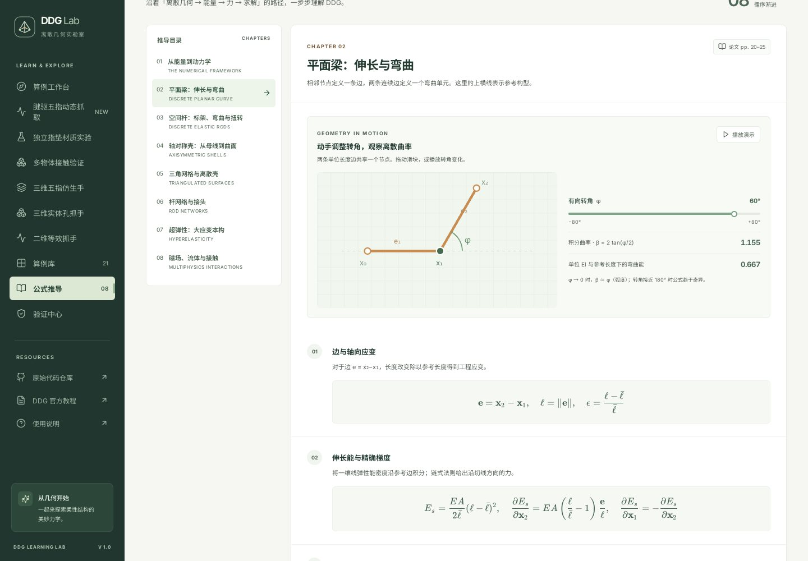

这里的 `0.667` 是页面规定单位参数下的局部示意值，不是实例 1 悬臂梁的实际总能量。

<a id="gripper2d"></a>
## 实例 3：二维等效抓手——4 mm 牵引

**目标：**观察二维柔性指体中的四个等效导向接触截面。

1. 点击左侧 **二维等效抓手**。默认路径会自动开始求解。
2. 在右侧确认 **最大牵引位移**为 `4.0 mm`、网格为“标准 · 140 单元”，且未勾选“到达最大牵引后卸载”；如改过参数，将它们改回后点击 **应用并重新计算**。
3. 等待视图上方状态变为 **已完成**，进度条右侧目标为 `4.0 mm`。
4. 在视图右侧观察“导向截面处于接触”，默认工况应显示约 **4 / 4**；下面的指端横向位移约 **17.71 mm**，腱张力约 **0.183 N**。
5. 点击视图右上方的**接触力箭头**按钮，可显示或隐藏箭头；也可拖动下方历史滑条回看已经接受的加载帧。
6. 向下找到 **加载响应**，切换“指端位移、腱张力、接触力”等曲线，点击 **导出 CSV** 保存 `tendon-gripper-equilibria.csv`。

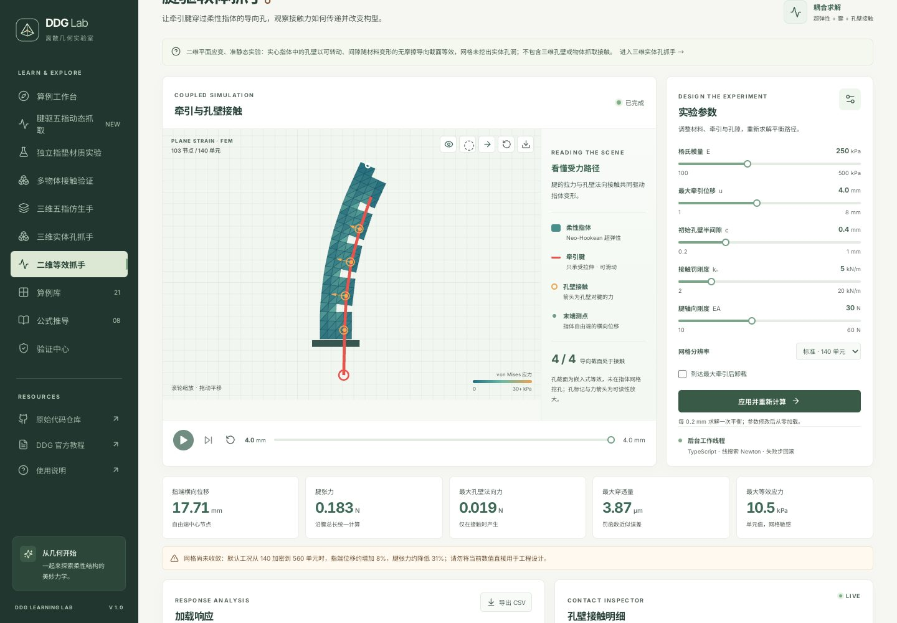

此页是**二维等效导向截面**：网格没有挖出真实三维孔洞，结果不能与下一个实例的三维孔壁直接等同。

<a id="gripper3d"></a>
## 实例 4：三维实体孔抓手——先算 0.5 mm 短路径

**目标：**快速观察实体指、腱与真实三维孔壁的准静态接触，不等待默认大卷曲全路径。

1. 点击左侧 **三维实体孔抓手**。页面进入后可能已开始默认计算。
2. 在右侧 **三维实验参数**中，将 **三维最大牵引**设为 `0.50 mm`。其他参数保持默认，实体网格选“标准 · 136 六面体”、腱段选“23 段 · 标准”。
3. 确认没有勾选“加载至峰值后实际求解卸载”，点击 **应用并重新计算**。这会终止旧工况并从初态重算。
4. 等待状态显示 **已完成**，视口下方显示 `0.50 / 0.50 mm`。本次操作的“指端实际转角”约 **3.21°**。
5. 点击视口上的 **透视显示腱与孔壁**按钮观察腱线；再点击 **沿变形后的末端孔轴查看真实孔口**按钮观察孔口。点击**重置三维视角**可返回。
6. 在 **响应与动画**区域选择“转角、位移、腱力或接触力”，点击 **导出 CSV** 或 **导出 GIF**。本短路径 CSV 有表头和 3 个平衡帧；GIF 对应这 3 帧。

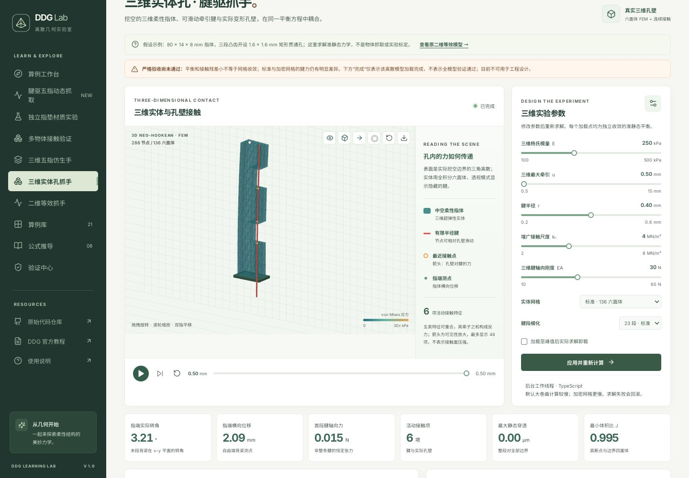

[查看沿孔轴的截图](screenshots/step-by-step/12-gripper3d-bore.jpg)

这只是 0.5 mm 的**短行程教学操作**。它不能证明大卷曲、网格收敛或连续材料的完整安全性；默认更大牵引路径会慢得多。

<a id="fixed-ball"></a>
## 实例 5：三维五指仿生手——观察固定球接触

**目标：**查看五根腱驱中空实体指对一个固定支撑球体的反力。

1. 点击左侧 **三维五指仿生手**。
2. 页面自动按默认目标计算；如果目标已被修改，点击右侧 **默认目标**，再点击 **应用并重新计算**。
3. 默认各指的实际目标牵引显示约为：拇指 `5.26 mm`、食指 `6.08 mm`、中指 `6.75 mm`、无名指 `6.21 mm`、小指 `5.26 mm`。这些是按指长相似缩放后的值。
4. 等待状态 **已到达目标**；已记录的默认路径末态为 `27 / 27 帧`、**5 / 5 指接触球体**。计算可能需要数分钟。
5. 点击视图工具切换**透视腱**和**接触标记**；下方表格显示每指角度、腱孔接触项和球体反力。
6. 在响应区域导出 CSV 或 GIF；拖动历史滑条可回看已接受的平衡帧。

[查看默认五指固定球操作截图](screenshots/68-bionic-hand-desktop.jpg)

蓝色球体由外部**固定支撑**，不是自由物体抓取。默认 `6.75 mm` 是相似尺度路径；已记录的 `7.00 mm` 请求因指间 CCD 不确定而回滚，不能自行认为更大目标也通过。

<a id="egg"></a>
## 实例 6：腱驱五指动态抓取——回放鸡蛋

**目标：**不等待重新求解，观察鸡蛋从临时夹具固定到被手指接触并抬升的已有轨迹。

### 第一步：加载预设

1. 点击左侧 **腱驱五指动态抓取**。
2. 在页面上方点击 **鸡蛋**。即使它已经被选中，重新点击也会恢复该物体的默认预设。
3. 等待三维画面加载。右侧应显示物体尺寸 `100%`、弹簧刚度 `1.00×`、横移 `−13 mm`、腱目标 `13.0 mm`、驱动器刚度 `150 N/m`、摩擦 `1.50`，并勾选连续碰撞检查。
4. 点击视图下方的 **查看鸡蛋预计算轨迹**。加载完成后，页面通常停在 `2.150 / 2.15 s` 的最后一帧。

### 第二步：从初态看到末态

5. 把视图下方历史滑条拖到**最左端**：时间为 `0.000 s`，图例显示 **临时夹具：启用**。
6. 点击播放按钮 `▶` 或逐步拖动滑条，观察手指闭合。临时夹具在约 `0.95 s` 后释放，手腕在约 `1.08 s` 后开始抬升。
7. 把滑条拖到**最右端**：时间为 `2.150 s`，图例显示 **临时夹具：已释放**。
8. 向下看结果：本录像末帧显示质心抬升约 **51.9 mm**、物体接触手指 **4 / 5**，且有拇指接触；结果条明确写着“达到降阶短时保持条件（力未收敛）”。

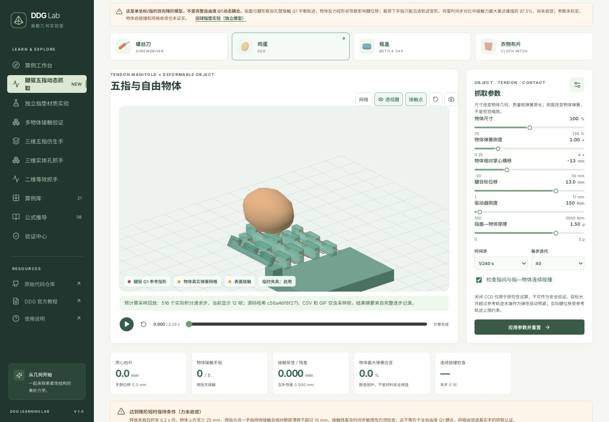

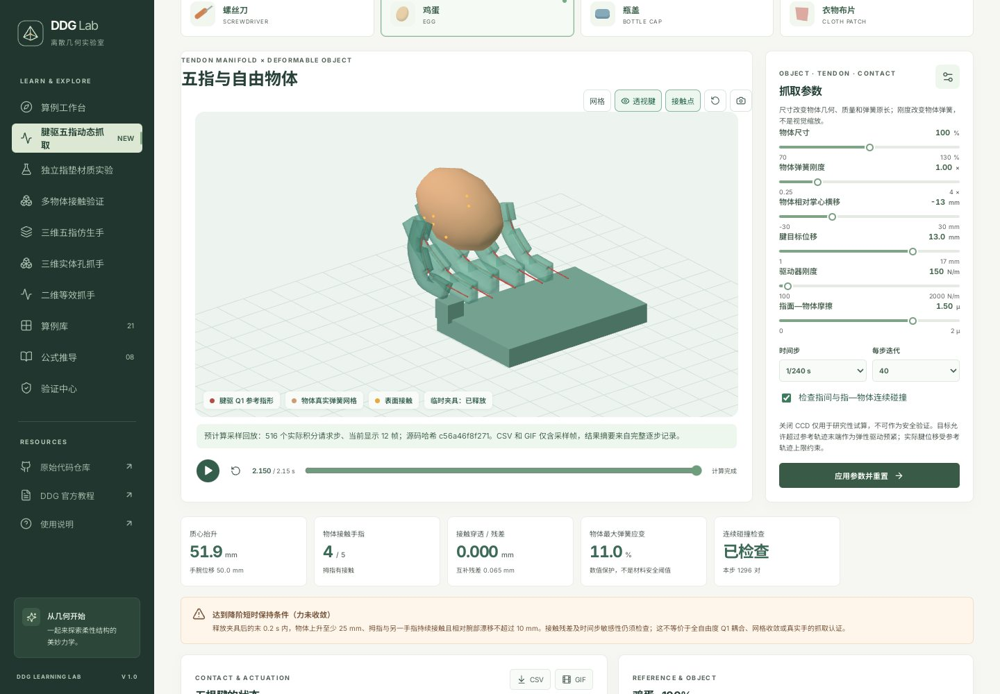

### 第三步：检查五指并保存

9. 向下滚动到 **五根腱的状态**，查看每指的实际腱位移、末段弯曲角与物体法向力。
10. 在同一区域点击 **CSV**，得到 `tendon-dynamic-egg.csv`；点击 **GIF**，得到 `tendon-dynamic-egg.gif`。视图上的相机按钮保存 PNG。
11. 要重新做一遍计算，而不是看录像：点击视图下方**重置仿真**，等状态为“点击开始”后，再点播放。新的实时计算可能耗时较长。

> 此录像从 516 个请求步中抽取 **12 个显示帧**；其 CSV 有 1 行表头和 12 行数据，GIF 也只有 12 帧。结果条的保持摘要来自原始完整逐步报告：即使拖回初态，它仍概括完整时程，不是当前帧的保持判定。12 帧不能代表全过程最大接触残差，也不能证明力收敛。

<a id="shapes"></a>
## 实例 7：比较不同形状——鸡蛋、螺丝刀、瓶盖

**目标：**使用各物体自带的不同尺寸和布置，查看末态接触。无需从头计算。

1. 在 **腱驱五指动态抓取**中，点击顶部 **螺丝刀**，等待视口加载。
2. 确认右侧自动变为尺寸 `80%`、横移 `−22 mm`、腱目标 `13.0 mm`、驱动器刚度 `150 N/m`。
3. 点击 **查看螺丝刀预计算轨迹**；拖到末端，观察约 `2.150 s`、抬升 `46.7 mm`、**3 / 5** 指接触。
4. 再点击顶部 **瓶盖**，确认尺寸 `130%`、横移 `−22 mm`、驱动器刚度 `200 N/m`。腱目标的预设实际为 `14.75 mm`，界面按一位小数显示 **14.8 mm**；保留预设即可，不必拖动该滑块。
5. 点击 **查看瓶盖预计算轨迹**；拖到末端，观察抬升约 `51.8 mm`、**4 / 5** 指接触。
6. 点击 **衣物布片**会进入该形状，但**没有预计算录像按钮**；需要自行计算，且已记录基线没有达到保持条件。

| 预设末帧 | 尺寸 | 横移 | 接触手指 | 质心抬升 | 截图 |
|---|---:|---:|---:|---:|---|
| 鸡蛋 | 100% | −13 mm | 4 / 5 | 51.9 mm | [查看](screenshots/step-by-step/05-egg-end.jpg) |
| 螺丝刀 | 80% | −22 mm | 3 / 5 | 46.7 mm | [查看](screenshots/step-by-step/06-screwdriver-end.jpg) |
| 瓶盖 | 130% | −22 mm | 4 / 5 | 51.8 mm | [查看](screenshots/step-by-step/07-cap-end.jpg) |

这些是**不同尺寸、位置和驱动参数**的三个特定演示，不是只改变形状的受控对照。它们的有限保持也不能推广到其他参数或真实物体。

<a id="stiffness"></a>
## 实例 8：腱驱五指——计算 4 倍刚度鸡蛋

**目标：**自己启动后台求解，比较 1× 与 4× 物体弹簧刚度。该实例比录像慢，速度依电脑性能而异。

1. 若需要保留实例 6 的 `1×` 数据，先导出 `tendon-dynamic-egg.csv` 并改名为 `egg-stiffness-1x.csv`。
2. 在 **腱驱五指动态抓取**页点击 **鸡蛋**，恢复该物体预设。
3. 在右侧把 **物体弹簧刚度**从 `1.00×` 调到 `4.00×`；其余参数保持：尺寸 `100%`、横移 `−13 mm`、腱目标 `13.0 mm`、驱动 `150 N/m`、摩擦 `1.50`、时间步 `1/240 s`、每步迭代 `40`。
4. 确认 **检查指间与指—物体连续碰撞**保持勾选，点击 **应用参数并重置**。
5. 等待状态为“点击开始”。因为这组参数不匹配默认录像，**查看预计算轨迹按钮会消失**；这是正常现象。
6. 点击播放按钮，状态变为 **Worker 计算中**。可点击暂停、再点击继续；不要在计算过程中刷新或切换页面。

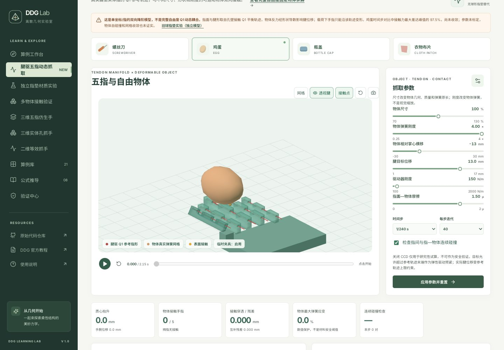

7. 等待 `2.150 / 2.15 s`、状态 **计算完成**。已记录的此工况末帧抬升约 **50.5 mm**，接触手指约 **4 / 5**；结果为该降阶模型的有限时段保持，**力仍未收敛**。
8. 在“五根腱的状态”点击 **CSV**，将下载文件另存或改名为 `egg-stiffness-4x.csv`；也可在暂停或完成后导出 GIF 和 PNG。
9. 与实例 6 对比时，注意 1× 录像 CSV 仅有 12 个采样帧；本次完整实时运行的页面历史通常含初始帧和每 4 个请求步的显示帧（此工况 CSV 共 131 行，含表头）。请按 `time_s` 对齐，不要直接把两份文件的第 N 行当作同一时刻。

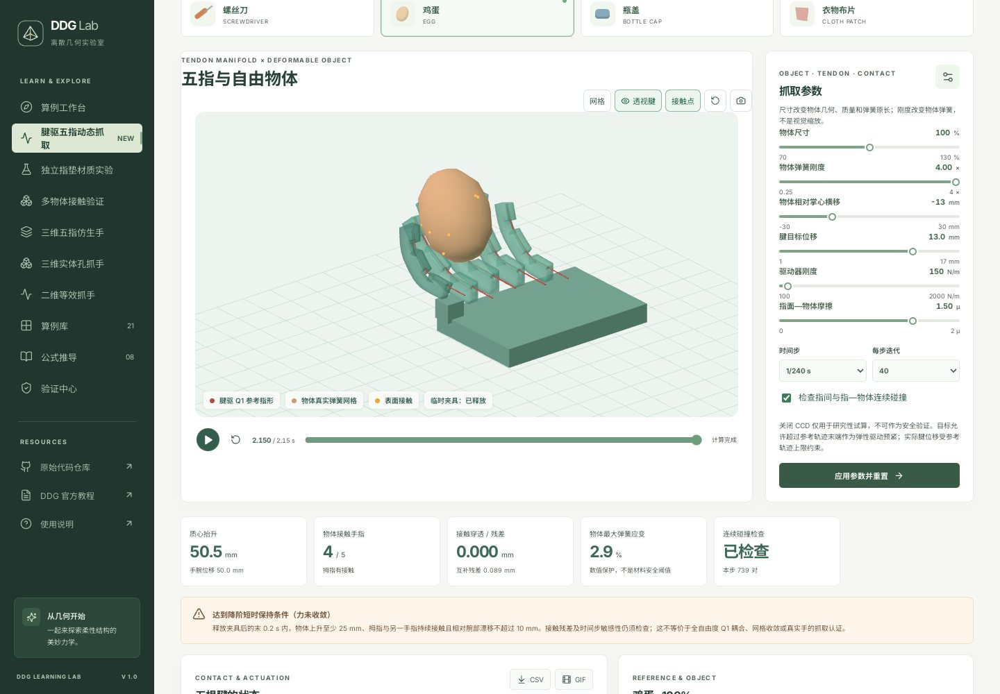

刚度倍率改变的是简化弹簧网络，不是已标定的鸡蛋蛋壳杨氏模量；上述对比不能证明材料安全或时间步收敛。

<a id="box"></a>
## 实例 9：多物体接触——固定圆角盒的 2 mm 路径

**目标：**改变物体形状，观察五指实体与固定圆角盒的准静态接触。

1. 点击左侧 **多物体接触验证**。
2. 在右侧“物体形状”下拉框选择 **圆角盒**，把 **物体尺寸倍率**设为 `100%`。
3. 点击下方 **短路径 2.00 mm**，再点击 **应用并重新计算**。仅选择形状或预设按钮还没有开始新工况。
4. 等待上方状态 **已到达目标**。已记录的该路径末态为 `8 / 8 帧`，约 **3 / 5** 指接触物体；页面显示的包络约 `90 × 80 × 50 mm`。
5. 拖动“物体平衡历史”滑条查看过程；切换透视和接触标记以观察腱与物体接触。
6. 向下到 **五指弯曲响应**，点击 **CSV** 或 **GIF**。此路径有初态加 8 个平衡增量；CSV 按 5 根指逐帧输出，共 46 行（含表头）。

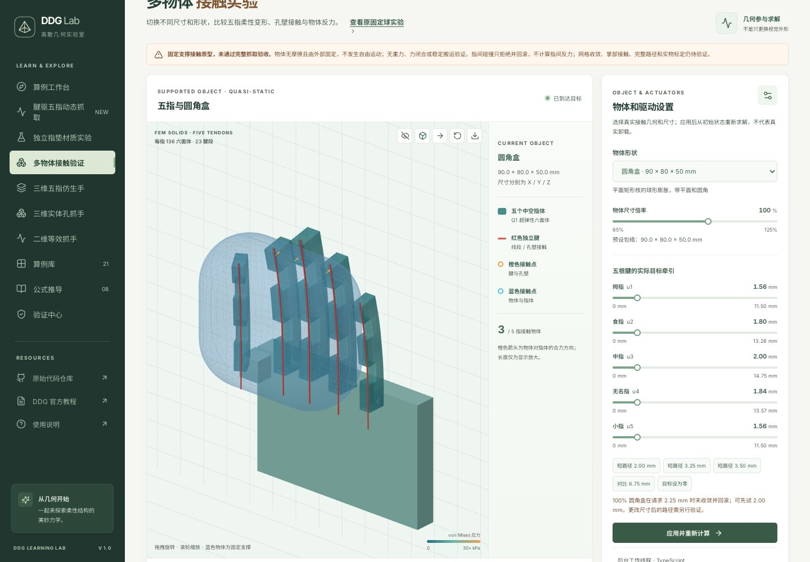

圆角盒在 `100%`、请求 `2.25 mm` 时已有未收敛并回滚记录。该页的物体固定、无摩擦和重力，不能视为自由抓取。

<a id="pads"></a>
## 实例 10：独立指垫材料实验——设置 2 倍刚度

**目标：**认识另一个材料演示页面，并避免把球形指垫误认为五腱实体手。

1. 点击左侧 **独立指垫材质实验**，选择顶部 **鸡蛋**。
2. 在右侧把 **材料连杆刚度倍率**设为 `2.00×`，其他参数先保持默认。
3. 点击 **应用参数并重置**，再点击视图下方播放按钮开始后台积分。
4. 等到时间超过 `0.20 s`，点击暂停按钮；页面显示 **已暂停**，进度时间依电脑速度而定。如果已经计算结束，点击重置后可重新开始。
5. 查看柔顺球形指垫、可变形物体网格以及下方接触力曲线；可以继续播放或导出当前已接受数据。

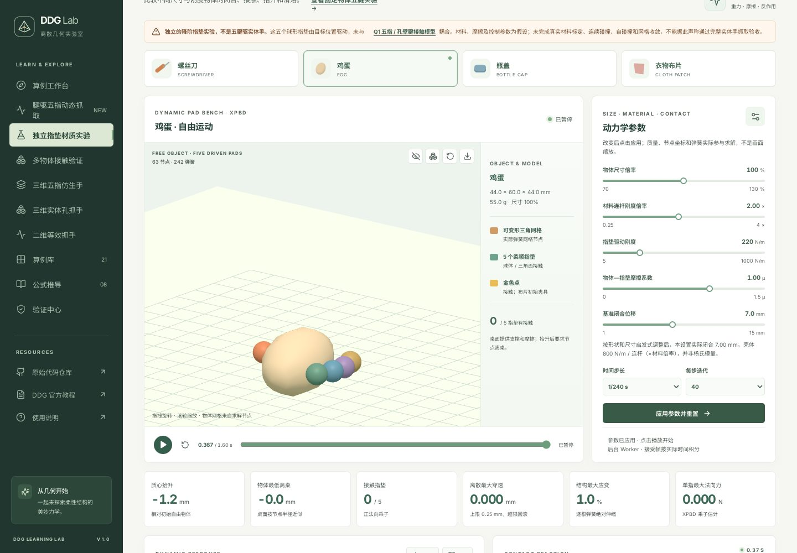

**注意：**这里的 5 个球形指垫由目标位置驱动，**没有与腱驱五指实体手耦合**。如果目的是观察实体腱驱手指，请回到实例 6 或 8。

<a id="verification"></a>
## 实例 11：验证中心——运行并读懂结果

1. 点击左侧 **验证中心**。
2. 点击右上角 **运行验证**，等待结果；不同电脑耗时不同。运行中可以点击 **取消验证**，取消后本次不算完成。
3. 完成后查看顶部三个数字：本次浏览器记录为 **15 / 15** 数值内核检查、**21 / 21** 算例可运行性、**10 / 21** 独立参考时窗通过。
4. 向下查看“参考代码局部数值对照”：已有 12 个算例存在独立参考时窗，其中 10 个达到严格阈值；梁跃迁和游动严格对照未通过。球冠另有**翻转条件诊断未通过**。
5. 继续向下查看“逐项算例检查”，点击某一算例可返回对应工作台，再选择“验证说明”了解适用范围。

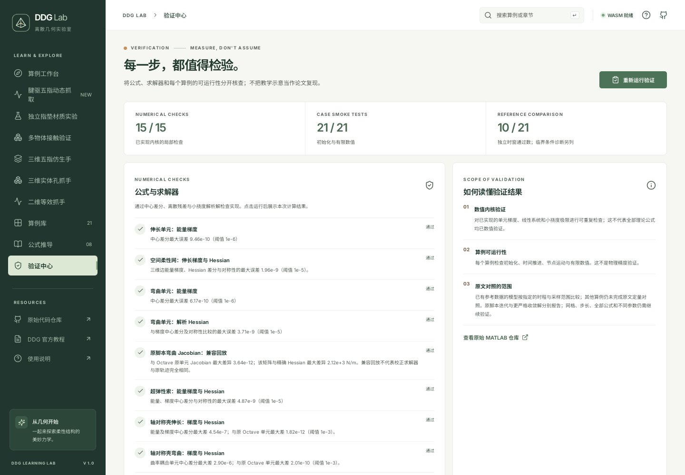

`15 / 15` 不代表全部理论公式均已验证；`21 / 21` 只表示这些算例可初始化并产生有限数值；`10 / 21` 不是 21 个算例全部物理通过。

<a id="troubleshooting"></a>
## 结果保存与常见问题

**1. 修改了滑块，为什么仿真没有变化？**

参数通常先作为草稿。点击本页的 **应用并重新运行**、**应用并重新计算**或**应用参数并重置**。这会清除旧的未导出历史。

**2. 为什么“查看预计算轨迹”不见了？**

只有鸡蛋、螺丝刀和瓶盖的**对应默认参数**有录像。重新点击相应物体可恢复预设；布片和自定义参数需自行计算。

**3. 为什么 GIF 按钮是灰色的？**

需至少两个已接受帧；动态实验需先暂停或等待计算结束。下载可能被浏览器拦截，请检查下载提示。

**4. CSV、PNG、GIF 保存在哪里？**

通常在浏览器的“下载”列表或系统下载文件夹。多个工况可能使用相同文件名，请及时改名，并另外记录物体、尺寸、刚度、摩擦、时间步、迭代次数与 CCD 状态。

**5. 看到了“回滚”或“未满足保持条件”？**

这表示当前尝试失败或未满足指定条件，不是通过。失败步不会进入导出历史。可以参考页面错误信息减少目标或调整参数，但不能保证新的工况收敛。

**6. 三维场景空白？**

使用浏览器的 HTTP 预览地址，不要双击 `index.html`；检查 WebGL 和硬件加速，再尝试更新浏览器。动态实验需要 Web Worker。

**7. 能否把某一个示例成功推广到所有尺寸和物体？**

不能。模型、接触、时间步和材料假设均有局限。详细推导、已通过范围和失败记录见[腱驱动态模型说明](TENDON_DYNAMIC_GRASP.md)及[完整使用说明书](USER_MANUAL.md)。

---

**操作复核范围：**[浏览器操作记录](screenshots/step-by-step/)覆盖这里的典型点击、参数、截图和导出；[自动化复现脚本](../scripts/audit-step-by-step.mjs)提供 `quick`、`gripper3d`、`box`、`stiffness`、`validation` 模式。脚本需要另外准备 Playwright 和 Chromium；按本手册手动操作不需要它们。这些是 UI 操作检查，不是完整物理、网格收敛或实验验收。
