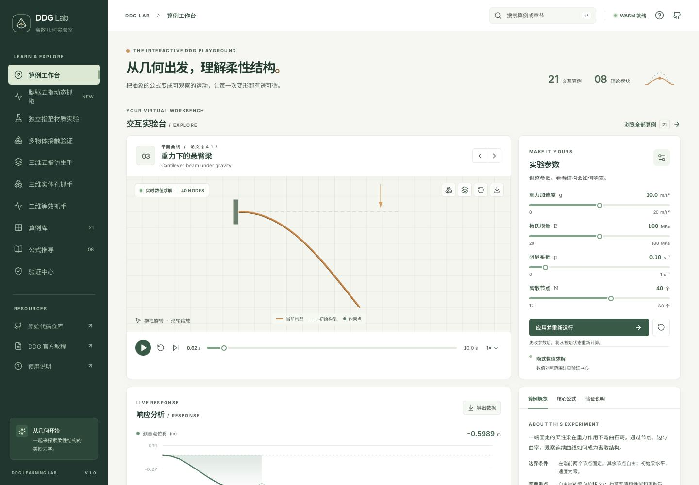
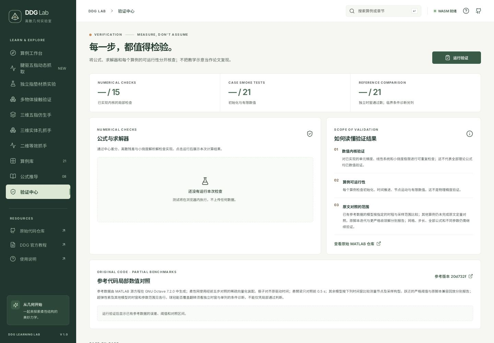
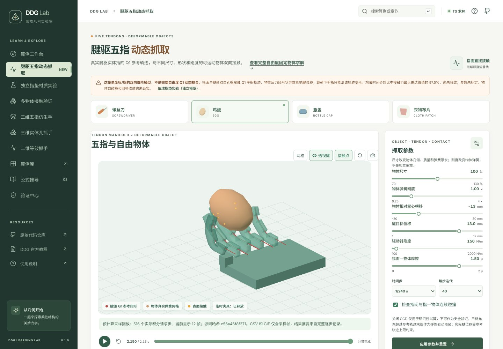

# DDG Lab 使用说明书

**适用版本：**当前项目分支的 DDG Lab 1.0　｜　**更新：**2026 年 10 月

DDG Lab 是一个中文交互式离散微分几何（DDG）学习与仿真应用。你可以在浏览器中观察 21 个柔性结构算例，阅读公式推导，运行数值检查，以及探索二维、三维腱驱抓手和五指接触实验。

> **使用前必读**
>
> 本应用是教学和研究原型，不是工程设计或人体安全认证软件。21 个算例中有 9 个是教学近似；部分原文参考对照未通过。五指动态抓取是**每指一个形状坐标的双向降阶模型**，不是五指、腱与物体的完整自由度联立求解。当前接触力尚未时间步收敛，布片基线未满足保持条件，用户提出的严格物理总体验收尚未通过。动画、截图或“短时保持”不代表真实抓取已验证。

**想跟着做？**请打开[分步操作实例（Step by Step）](STEP_BY_STEP.md)，包含具体点击、参数、预期结果、截图和导出示例。

## 目录

1. [安装与启动](#start)
2. [认识界面与导航](#navigation)
3. [算例工作台](#workspace)
4. [算例库与 21 个算例](#library)
5. [公式推导](#theory)
6. [验证中心](#validation)
7. [腱驱五指动态抓取](#tendon)
8. [其他抓手与接触实验](#other-labs)
9. [结果指标与导出文件](#results)
10. [常见问题](#faq)
11. [进一步阅读](#references)

<a id="start"></a>
## 1. 安装与启动

### 1.1 使用现成预览

如果当前会话提供了 **Website / 网站预览**，直接打开预览即可，不需要在自己的设备安装开发工具。首次进入三维实验时，参考数据和页面资源可能需要一些加载时间。

### 1.2 在自己的电脑运行

需要：

- Node.js 20 或更新版本（推荐 Node.js 22）、npm 和 Git；
- 支持 WebGL、WebAssembly 和 Web Worker 的现代浏览器；Chrome/Chromium 的桌面和手机视口已做过浏览器审查；
- 首次下载项目与安装依赖时需要网络。应用部署好后，仿真在浏览器本地运行；论文、教程和 GitHub 等外部链接仍需要网络。

在终端执行：

```bash
git clone --branch arena/7bf8ff28-mathhighschool https://github.com/hnsyliupeng/mathhighschool.git
cd mathhighschool
npm ci
npm run dev
```

用浏览器打开终端显示的 **Local** 地址，例如 `http://localhost:5173/`；如果端口已占用，请使用终端实际给出的地址。关闭终端中的服务可按 `Ctrl+C`。

> 这里的 `localhost` 指**运行服务的那台电脑**。使用远程预览时，请打开预览提供的链接，不要在自己设备上输入远程机器的 `localhost`。

如需检查生产构建：

```bash
npm run build
npm run preview
```

然后打开终端显示的预览地址。请通过 HTTP 服务访问，**不要双击 `index.html`**：模块、Worker、数据文件与 WASM 都需要正确的 URL 和 MIME 类型。开发和预览服务没有用户认证，不应直接暴露到不受信任的网络。

**Rust 是否必需？**正常使用不需要自行安装 Rust：项目已经包含浏览器 WASM 文件。只有修改并重新编译 Rust 数值内核时，才需要 Rust 工具链和 `wasm32-unknown-unknown` 目标。WASM 无法加载时，部分通用数值内核会回退到 JavaScript；抓手实验使用 TypeScript 求解。

<a id="navigation"></a>
## 2. 认识界面与导航



左侧导航列出主要页面；手机端先点击左上角的 **菜单按钮**。点击页面名称后，浏览器的前进/后退可返回先前的页面、算例或理论章节。上方搜索框输入关键词并按 Enter，可进入算例库搜索。

| 导航名称 | 功能 | 直接访问时的地址参数 |
|---|---|---|
| 算例工作台 | 查看、控制和导出当前算例 | `?page=workspace` |
| 腱驱五指动态抓取 | 实体指参考形状与自由物体的降阶动态接触 | `?page=tendon3d` |
| 独立指垫材质实验 | 五个球形指垫与不同物体的独立降阶实验 | `?page=materials3d` |
| 多物体接触验证 | 五指与固定支撑的球、胶囊、盒等接触 | `?page=objects3d` |
| 三维五指仿生手 | 五根腱驱实体指与固定球体接触 | `?page=hand3d` |
| 三维实体孔抓手 | 单指真实三维孔壁与腱的准静态接触 | `?page=gripper3d` |
| 二维等效抓手 | 带等效导向截面的平面腱驱指 | `?page=gripper` |
| 算例库 | 选择和搜索 21 个算例 | `?page=library` |
| 公式推导 | 阅读 8 个主题和几何互动 | `?page=theory` |
| 验证中心 | 本地运行数值、可运行性和参考对照 | `?page=validation` |

把参数加在当前应用地址末尾即可，例如 `http://localhost:5173/?page=workspace&case=beam-gravity`。实际主机与端口以你的部署地址为准。页面地址可用于分享页面、选定算例或章节；**参数草稿、求解过程和结果不会因复制地址而自动保存**。

通用操作：

- 大多数三维视图可用鼠标拖拽旋转、滚轮缩放；可点击视图上的**重置视角**恢复。二维抓手视图不能旋转，但可缩放。
- 鼠标停留在图标按钮上通常可查看提示；键盘可用 Tab 移动焦点。帮助对话框和手机导航可用 Escape 关闭。
- 顶部的 **WASM 就绪 / JS 核心**表示通用小型数值内核的状态；**TS 求解**表示当前抓手求解器使用 TypeScript，不表示 Rust 正在求解该抓手。
- 刷新、切换实验或重新应用参数通常会清除当前未导出的历史。请先下载需要保留的数据与图片。

<a id="workspace"></a>
## 3. 算例工作台

### 3.1 第一次运行：重力下的悬臂梁

1. 在左侧选择 **算例工作台**。默认算例是“重力下的悬臂梁”，页面会自动开始推进。
2. 在三维/二维视图中观察梁形状；使用视图右上角按钮切换节点、初始构型、重置视角或下载 PNG。
3. 使用视图下方的**暂停/播放**、**重置仿真**、**单步前进**、时间滑条与播放速度按钮。拖动滑条可回看已记录状态。
4. 在右侧更改重力、杨氏模量、阻尼或离散节点数，再点击 **应用并重新运行**。只拖动滑条不会立即重算。
5. 在下方 **响应分析**查看位移曲线、弹性能和残差；点击 **导出数据**下载 CSV。
6. 在右下方切换 **算例概览 / 核心公式 / 验证说明**。公式初次打开会按需加载；可继续进入对应的理论章节或验证中心。

从历史位置恢复播放时，系统会从该状态继续，并截断其后的旧轨迹。失败的数值步会显示警告，保留最后接受的状态；不要把失败尝试当作已验证结果。

### 3.2 参数与曲线的含义

各算例的可调项目不同。界面可能显示载荷或路径倍率、材料刚度、阻尼、节点数等；更改参数会使结果离开默认参考工况。准静态例中的“时间”可能只是加载路径参数，不一定表示真实惯性时间。

部分模型可切换 **位移—时间**和**载荷/反力—位移**图。`J`、应变和残差应结合各页文字理解：残差小只说明指定离散方程在相应容差内求解，不能单独证明物理模型、材料强度或网格收敛。

<a id="library"></a>
## 4. 算例库与 21 个算例

进入 **算例库**，点击顶部分类筛选，或在“搜索算例”中输入名称、英文、章节号或标签；点击卡片即可进入工作台。卡片标记为 **数值求解**或**约束示意**；后者是教学近似，不等同于论文原模型。

| 分类 | 算例 |
|---|---|
| 动力系统 | 单自由度弹簧振子；多自由度弹簧系统 |
| 平面曲线 | 重力下的悬臂梁；受压梁的屈曲；预屈曲梁的跃迁 |
| 空间曲线 | 重力下的空间螺旋杆；预屈曲带的分叉；环形带的生长 |
| 轴对称曲面 | 轴对称平板充气；轴对称球冠翻转 |
| 空间曲面 | 重力下的薄板挠曲；薄板的重力褶皱；圆柱壳的局部压痕 |
| 杆网络 | 重力下的柔性网；网壳的形态生成；重力下的空间格构 |
| 超弹性 | 超弹性平面索；超弹性轴对称膜 |
| 软体机器人 | 磁场驱动柔性梁；流固耦合软体游动；摩擦接触软体爬行 |

算例的描述、边界、载荷、观察量和局限见工作台中的**算例概览**与**验证说明**。链接到的官方 MATLAB 代码和动画是外部参考，并非本地计算结果。

<a id="theory"></a>
## 5. 公式推导

点击 **公式推导**，在目录选择 8 个主题：通用框架、平面梁、空间杆、轴对称壳、离散壳、杆网络、超弹性和多物理场。每一章按几何、能量、力与求解步骤组织；页面中的提示说明公式与当前算例实现之间的差别。

- **平面梁：**拖动“离散转角”或点击“播放演示”，观察积分曲率和弯曲能的变化。
- **空间杆：**调整弯曲转角和材料标架转角，或点击“播放扭转”，观察两条边的积分曲率和扭转。该示意是局部几何实验，不是完整空间杆动力学求解。
- 手机端章节目录可横向滑动；较长的公式框也可横向滚动。

<a id="validation"></a>
## 6. 验证中心



1. 选择 **验证中心**，点击 **运行验证**。
2. 等待数值检查、算例可运行性和参考数据对照完成；运行中可点击 **取消验证**，或离开页面。
3. 查看每一行的误差、阈值、范围与“通过 / 未通过 / 未验证”状态，再点击算例行进入对应工作台。

三个汇总数字含义不同：

| 指标 | 检查什么 | 不代表什么 |
|---|---|---|
| 数值内核检查，当前 15 项 | 已实现单元的局部差分、残差等 | 全部理论公式或工程模型均已验证 |
| 算例可运行性，当前 21 项 | 初始化、推进和有限数值等 | 与原论文定量一致 |
| 参考对照，以 21 个算例为分母 | 指定参数、时窗和采样范围内的独立参考对照 | 全参数、全时程或物理实验验证 |

当前有 12 个算例具备独立参考时窗，其中 10 个达到各自严格阈值，因此界面可显示 **10 / 21**；梁跃迁和流体阻力游动的严格对照未通过。球冠的独立参考只覆盖前段，另列的翻转条件诊断未通过。不同设备结果应以本次实际运行和页面说明为准。

参考对照通常在 Worker 运行。Worker 不可用时会尝试主线程回退；该同步回退开始计算后不能即时中断，页面可能暂时无响应。若 WASM 不可用，相关 Rust/JS 比较会显示“未验证”，不应将其当作通过。

<a id="tendon"></a>
## 7. 腱驱五指动态抓取



此页将五根实体指的**自由指 Q1 参考形状**与可运动物体的三角面直接接触，物体反力会影响每指的一个降阶形变坐标。它不是球形指垫替代，但加载时手指不能偏离该预计算形状轨迹，故也不是完整 Q1 自由度双向耦合。

### 7.1 快速查看预计算轨迹

1. 选择左侧 **腱驱五指动态抓取**，等待视口加载完成。
2. 选择 **鸡蛋**、**螺丝刀**或**瓶盖**。各自的默认预设与一条已有录像对应。
3. 点击视口下方的 **查看……预计算轨迹**。页面会载入 12 个采样帧，并显示原始完整报告中的摘要。
4. 点击播放按钮回放，或拖动历史滑条逐帧查看；可用 **网格、透视腱、接触点、重置视角、保存截图**改变观察方式。
5. 在下方“五根腱的状态”查看各指实际腱位移、末段弯曲角与物体法向力，并可下载 CSV 或 GIF。

预计算录像对应原始 **516 个请求步**，但页面、该录像的 CSV 和 GIF 只包含 **12 个采样帧**，不能用这 12 帧推断全过程的最大值或收敛性。布片没有此预计算回放；修改预设参数后，需要重新计算。若想在查看录像后重新计算，点击视图下方的**重置仿真**，等待就绪再点击开始。

### 7.2 自己计算一个工况

1. 选择物体：**螺丝刀、鸡蛋、瓶盖、衣物布片**。
2. 修改右侧参数；点击 **应用参数并重置**，等待状态变为“点击开始”。
3. 点击播放按钮开始后台计算。计算可能慢于仿真时间；可暂停、继续或重置。GIF 导出需先暂停或等待结束。
4. 观察视口中的“临时夹具：启用 / 已释放”、接触点、质心抬升以及每指状态。默认过程在约 `0.95 s` 后释放夹具，约 `1.08 s` 开始抬升。
5. 完成后阅读结果卡片；如果提示失败并回滚，失败步不会进入轨迹。保留需要的数据，再尝试调整参数。

| 参数 | 作用与操作提示 |
|---|---|
| 物体尺寸 `70%–130%` | 改变求解几何、质量及弹簧原长，不只是放大画面 |
| 物体弹簧刚度 `0.25×–4×` | 改变简化物体网络的弹簧刚度；不是已经标定的真实材料参数 |
| 物体相对掌心横移 | 改变初始位置，可影响是否形成对指接触 |
| 腱目标位移 | 调节驱动目标；实际腱位移仍受参考轨迹上限和各指尺度约束 |
| 驱动器刚度 | 调节目标与当前腱形变之间的柔顺驱动，单位 N/m |
| 指面—物体摩擦 | 调节模型摩擦系数，取值与实物材料无自动对应关系 |
| 时间步、每步迭代 | 改变积分或接触迭代；应分别比较结果，不能假设增加迭代就已收敛 |
| 检查指间与指—物体连续碰撞 | 默认开启；关闭仅供研究试算，不能用于安全验证或满足短时保持指标 |

页面实时计算时，为降低显示负担，Worker 通常每 4 个请求步发送一个显示帧，另包含终帧；当前页面的 CSV 记录显示历史，GIF 最多采样 30 帧。完整保持摘要来自 Worker 内的逐步历史。参数或页面重置后，这些内存数据不会自动保存。

### 7.3 如何判断结果

“达到降阶短时保持条件”要求完整时程、夹具释放，并在末 `0.2 s` 内满足最低抬升、拇指与另一指持续接触、相对腕部漂移及逐步 CCD 等指定数值条件。它不是力闭合证明、网格收敛证明或真实物体安全证明。

| 已保存的特定工况 | 本模型中的观察 | 注意 |
|---|---|---|
| 鸡蛋 100%，横移 −13 mm | 有限末段保持，最低抬升约 51.88 mm，4 指含拇指接触 | 不等于接触力收敛或蛋壳强度验证 |
| 螺丝刀 80%，横移 −22 mm | 有限末段保持，最低抬升约 46.65 mm，3 指含拇指接触 | 不代表其他位置或尺寸也保持 |
| 瓶盖 130%，横移 −22 mm | 有限末段保持，最低抬升约 51.78 mm，4 指含拇指接触 | 该工况结构弹簧最大应变约 21.3%，未验证材料强度 |
| 布片 100%，横移 0 | **未满足保持条件**；末段最低抬升约 17.88 mm | 尚无布片自碰撞与真实织物标定 |

这些数字只适用于文档列出的其他默认参数与指定工况。鸡蛋前 `0.6 s` 的 `1/240 s` 与 `1/480 s` 对照中，中指接触力最大差约为峰值的 **97.5%**，说明力对时间步敏感、尚未收敛。详见 [模型与数值记录](TENDON_DYNAMIC_GRASP.md)。

可直接观看示例：[鸡蛋 GIF](media/tendon-dynamic-egg.gif) · [螺丝刀 GIF](media/tendon-dynamic-screwdriver.gif) · [瓶盖 GIF](media/tendon-dynamic-cap.gif)。它们均为采样动画，不是物理验收凭证。

<a id="other-labs"></a>
## 8. 其他抓手与接触实验

### 8.1 三维实体孔抓手

在 **三维实体孔抓手**中，单根有限半径腱穿过真实挖空的三维指体孔壁。进入后会逐步求解默认大卷曲路径，可能比较慢。可调整杨氏模量、最大牵引、腱半径、接触尺度、腱刚度、实体网格与腱段细化，然后点击 **应用并重新计算**。

- 用视图按钮切换表面网格、透视腱、接触力，或沿变形后的孔轴观察孔口；可重置视角和下载 PNG。
- 播放、单步和滑条用于回放已接受的平衡帧；CSV 和 GIF 在“响应与动画”区域。
- 可勾选“加载至峰值后实际求解卸载”。这与仅倒放已有动画不同。
- 默认 14.75 mm 牵引时，标准网格自由指末段实际转角约 92.29°；这一数值不是网格收敛证明。内部体积路径、材料标定等仍有未完成项。

### 8.2 三维五指仿生手

选择 **三维五指仿生手**，调整拇指、食指、中指、无名指和小指的目标牵引，或选择预设按钮，再点击 **应用并重新计算**。观察五指接触数、各指腱孔项、球体反力和路径指标；可回看平衡帧并导出 CSV、PNG、GIF。

这里的球体由外部**固定支撑**，不自由运动、无摩擦；指间碰撞只拒绝并回滚，不计算指间反力，因此不能当作自由抓取或力闭合验证。已记录的相似尺度 7.00 mm 路径在拇指—食指 CCD 上不确定并回滚到 6.75 mm，其他参数也必须分别检查。

### 8.3 多物体接触验证

选择 **多物体接触验证**，从三种尺寸球体、胶囊棒、圆角盒和双球哑铃中选形状；调整尺寸倍率与五根腱目标后，点击 **应用并重新计算**。页面提供短路径预设与已保存的比较记录。

可先试：

- 100% 胶囊棒：选择 **短路径 3.25 mm**；已记录的 3.50 mm 请求会回滚。
- 100% 圆角盒：选择 **短路径 2.00 mm**；已记录的 2.25 mm 请求未收敛并回滚。

以上路径使用各指的相似尺度换算，尺寸改变后不能沿用原结论。这里的物体**固定、无摩擦、无重力**，不能代替自由物体抓取。

### 8.4 独立指垫材质实验

选择 **独立指垫材质实验**，选择螺丝刀、鸡蛋、瓶盖或布片，设置尺寸、材料连杆刚度、指垫驱动刚度、摩擦、闭合位移、时间步和迭代数，点击 **应用参数并重置**，再点击播放。可查看抬升、离桌间隙、接触力、敏感性表格并导出 CSV/PNG/GIF。

**这一页的五个球形指垫与五腱实体手没有耦合。**它仅供比较简化材料/接触行为，不可作为腱驱仿生手抓取验证。布片有初始上沿夹具，页面会显示夹具状态；模型未完成自碰撞、材料标定和网格收敛。

### 8.5 二维等效抓手

选择 **二维等效抓手**，调整杨氏模量、最大牵引位移、孔壁半间隙、接触罚刚度、腱刚度或网格分辨率，点击 **应用并重新计算**。可切换网格、初始轮廓和接触力箭头，回看加载历史，查看接触力/能量曲线并导出 CSV、PNG。

这是平面应变指体及嵌入式导向截面；网格**没有挖出真实三维孔洞**。它与三维实体孔抓手是不同模型，不应混用两者的穿透量或张力结论。

<a id="results"></a>
## 9. 结果指标与导出文件

| 项目 | 使用说明 |
|---|---|
| PNG | 保存当前视角与当前帧的视口截图，不包含整个页面和全部参数 |
| CSV | 保存当前页面提供的已接受历史；列名与单位以首行为准，失败尝试不进入历史 |
| GIF | 将历史帧或采样帧编码成动画；不是完整求解过程或精度证明，生成时可能需要等待 |
| 质心抬升 | 物体质心相对初始状态的竖直变化；应同时检查夹具、腕部位移与保持窗口 |
| 接触手指数/法向力 | 与当前模型接触判定和乘子有关；显示力未经过实物标定 |
| 穿透、互补残差 | 数值接触约束的误差指标；容许范围不是“零穿透”或工程安全保证 |
| 弹簧应变 | 简化物体网络的伸缩量，不是材料破坏或强度判据 |
| CCD、路径 `J` | 对程序定义的数值路径和离散几何进行检查；不等于所有连续材料、内部体积与自碰撞的完整安全证明 |

常见单位：`1 mm = 1000 μm`；N 为牛顿，N/m 为弹簧刚度，s 为秒，`%` 为百分比。工作台 CSV 包含 `time_s`、`displacement`、`displacement_unit`、`elastic_energy_J` 等列；腱驱动态 CSV 包含 `time_s`、`fixture_active`、`rise_m`、各指位移和法向力等列。未计算的量可能为空或显示“—”。

建议为每次对比单独记录：**页面和物体、所有参数、是否启用 CCD、完成/失败状态、导出时间、时间步、迭代数、软件版本**。改变一个参数后要重新应用，且不要将不同模型的结果直接视为同一物理实验。

<a id="faq"></a>
## 10. 常见问题

**Q：页面空白、三维视图无法显示？**

确认通过 HTTP 地址而不是双击文件访问；检查浏览器是否支持并启用了 WebGL/硬件加速，刷新页面并查看错误提示。远程预览请使用其提供的地址。若仍失败，尝试更新浏览器或换一台支持 WebGL 的设备。

**Q：参数改了，但画面没变化？**

多数参数先进入草稿，必须点击 **应用并重新运行**或**应用参数并重置**。计算完成前也可能仍显示上一个接受帧。

**Q：为什么计算很慢？**

三维实体孔、五指和动态接触需要多次非线性求解与碰撞检查。更细网格、更小时间步和更多迭代通常更耗时。可以先使用短路径或预计算轨迹观察；不要通过关闭安全检查声称验证通过。

**Q：显示“回滚”“未满足保持条件”怎么办？**

这是有效的失败提示，不是成功。阅读页面给出的原因；可降低目标牵引、改变物体位置或尺寸、检查时间步与迭代后重跑，并保留失败记录。调整参数不保证收敛；已知未通过项仍需独立验证。

**Q：为什么没有“查看预计算轨迹”按钮？**

请等待参考数据加载，选择鸡蛋、螺丝刀或瓶盖的对应默认预设。布片没有预计算录像，修改过的参数也不匹配录像。可重新选择物体恢复其预设。

**Q：为什么不能导出 GIF 或 CSV？**

需先有足够的已接受帧；动态 GIF 在计算中禁用，请暂停或等待结束。确认浏览器允许下载，并在切换页面或重置之前保存。

**Q：验证结果不是全部绿色，是否是程序出错？**

不一定。应用保留了已知严格对照失败和未完成项，例如梁跃迁、游动参考对照和球冠翻转诊断；它们不应被自动改成“通过”。若出现加载失败、非有限值或新的错误，请记录具体页面、参数和浏览器信息。

<a id="references"></a>
## 11. 进一步阅读

- [项目 README](../README.md)：运行方式、各算例实现和参考对照概况。
- [全应用审查记录](APP_REVIEW.md)：浏览器、性能、无障碍自动扫描与测试范围。
- [腱驱五指动态模型与失败记录](TENDON_DYNAMIC_GRASP.md)：公式、预设参数、碰撞范围、时间步对照与剩余工作。
- [三维实体孔抓手](TENDON_GRIPPER_3D.md) · [三维五指仿生手](BIONIC_HAND_3D.md) · [固定多物体接触](MULTI_OBJECT_GRASP_3D.md) · [独立指垫材质实验](MATERIAL_GRASP_3D.md) · [二维等效抓手](TENDON_GRIPPER.md)。
- [算例验证记录](VALIDATION.md) · [21 个视图截图总览 01–07](screenshots/review-01.jpg) · [08–14](screenshots/review-02.jpg) · [15–21](screenshots/review-03.jpg)。
- 原始参考：[DDG Tutorial MATLAB 仓库](https://github.com/weicheng-huang-mechanics/DDG_Tutorial) · [DDG FlexSim 网站](http://www.ddgflexsim.com/) · [Huang 等人的教程论文](https://arxiv.org/abs/2504.11417)。
